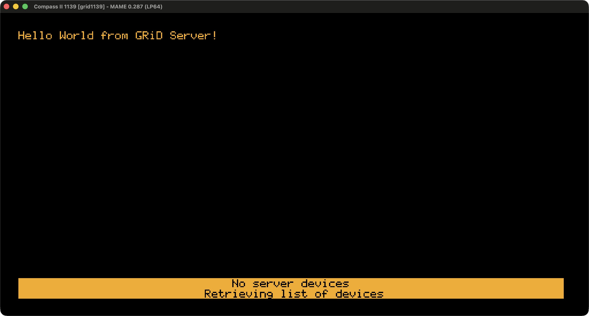

# GRiD Compass

A reimplementation of GRiD Server and other projects focused on the built-in modem and applications of the GRiD Compass laptop.

  <a href="https://www.youtube.com/watch?v=FKbSp-bifZE">Video demo of an early server version with a very slow modem.</a>

## Setochka Server

Setochka is a software reimplementation of the original GRiD Server. It lets you exchange files and mail between these iconic laptops, even 50 years later.

The first public release is in preparation.

See [Server/README.md](Server/README.md) for build, setup, and configuration instructions.

If you find a problem, [open an issue](https://github.com/vklachkov/grid-compass-network/issues/new). I will try to respond soon.

## Modem

The original modem schematics and technical documentation have not been found yet. I do not have a physical modem, so I do not know how its hardware works.

But the built-in modem driver from MS-DOS 2.11C was reverse-engineered. This work led to a [MAME pull request with a proof-of-concept modem emulator](https://github.com/mamedev/mame/pull/15627).

A Wi-Fi card is being developed to replace the original slow modem.

## Reverse Engineering

See [Reverse Engineering/README.md](Reverse%20Engineering/README.md) for details on reverse engineering GRiD Server applications and protocols.

## LLM Disclosure

I used LLM-based tools to help with reverse engineering and programming parts of this project. I reviewed their contributions and made the technical decisions myself. This is not unchecked "vibe coding": I take full responsibility for the code, research, and any remaining errors.

## License

The project code is released under the [MIT License](LICENSE). Original firmware, third-party articles, and technical documentation remain the property of their respective copyright holders and are not covered by this license.
